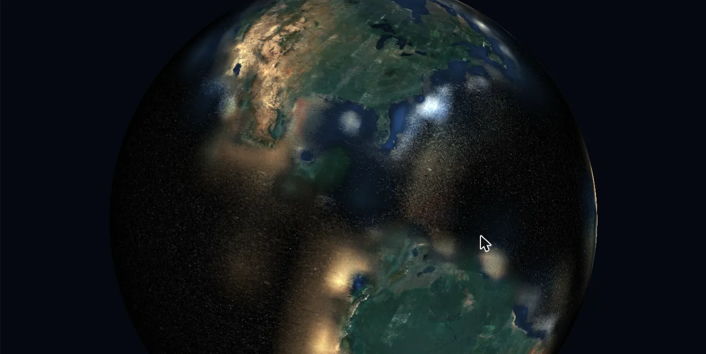

Drag to rotate, scroll to zoom. Keys: 1–4 pick a layer, R resets, F goes fullscreen, S hides the stats.

Everything you see above is a neural network. There is no globe texture, no tile pyramid, no mesh — each pixel casts a ray at a sphere, takes the hit point, looks it up in a multi-resolution hash grid and pushes the result through a small MLP. That happens for every pixel, every frame, in a single WebGPU compute kernel on your GPU.

The model is a multi-scale spherical neural field. It is an [instant-NGP](https://nvlabs.github.io/instant-ngp/) style hash grid: 16 resolution levels, two features per level, hashed into a 224-entry table, followed by a 64-wide MLP with two hidden layers. Seven output channels — RGB, elevation, tree cover and a couple of extras — come out of one forward pass, so the layer buttons just pick which channels to show.

- WebGPU only: Chrome and Edge 113+, Safari 26+, Firefox 141+, on a real GPU. On an integrated GPU the interactive resolution scales itself down and refines when you stop dragging, capped at 40 frames/s
